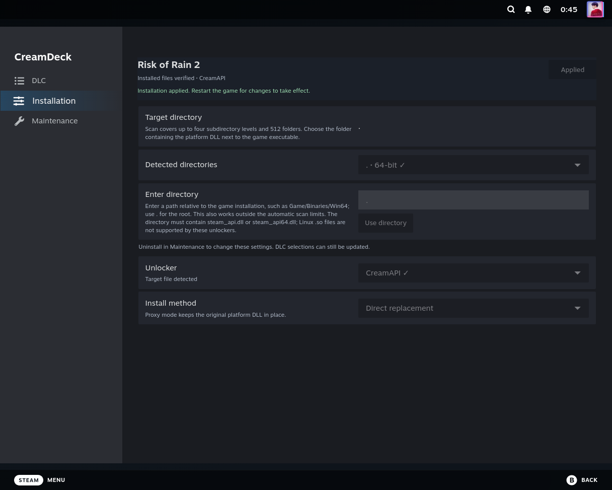

# CreamDeck

[](https://github.com/Qiming-Liu/CreamDeck/actions/workflows/pr-build-test.yml)
[](./LICENSE)

A [Decky Loader](https://github.com/SteamDeckHomebrew/decky-loader) plugin for
managing Steam DLC unlockers on Steam Deck, using **SmokeAPI** and **CreamAPI**.
Supports Windows games running through Proton; native Linux games are not supported.

## Installation

Download **CreamDeck.&lt;version&gt;.zip** from the [latest release](https://github.com/Qiming-Liu/CreamDeck/releases/latest)
and install it through Decky Loader's developer settings. Use the plugin ZIP,
not GitHub's **Source code.zip**.

## Using the plugin

Open **CreamDeck** from an installed game's library context menu.

The page has three sections:

1. **DLC**: search and select DLC, or refresh the catalog.
2. **Installation**: choose the target folder, unlocker and install method.
   The folder must contain `steam_api.dll` or `steam_api64.dll`. If automatic
   detection misses it, enter its path relative to the game installation.
3. **Maintenance**: uninstall or clean verified unlocker files. Files changed
   by a game update or another tool are preserved.

New installations default to **CreamAPI + direct replacement**. Select DLC,
then click **Install**. If you choose proxy mode instead, enable the
**Proton launch option** switch in Installation.
Restart the game afterward. Later DLC selections use **Apply changes**; uninstall
first to change the unlocker or install method.




## Important notes

- Unlockers do **not** download DLC files. Required content must already be
  installed; enabling missing content can cause crashes. A **⚠** marks DLC
  with a separate Steam depot.
- Proxy mode requires `WINEDLLOVERRIDES="version=n,b" %command%` when using
  `version.dll`. The Proton launch option switch manages this while preserving
  other launch options. If DLC stays locked, check the switch and restart the game.
- Steam's **Verify integrity** restores DLLs replaced by direct installation.
  Reinstall afterward, or use proxy mode.
- If files need repair, open **Maintenance** before reinstalling. A failed
  catalog refresh keeps cached DLC data and leaves Maintenance available.

## Development

```bash
pnpm install
pnpm run build
node_modules/.bin/tsc --noEmit -p .
python -m unittest discover -s tests -v
```

See [scripts/DEV.md](scripts/DEV.md) for live testing over SSH with `pnpm dev`.

## Special thanks

- [CreamInstaller](https://github.com/FroggMaster/CreamInstaller) for the original
  DLC selection and installation workflow and bundled unlocker resources.
- **CreamAPI** by deadmau5 and **SmokeAPI** by [acidicoala](https://github.com/acidicoala).

## License

GPL-3.0. Bundled unlocker resources retain their respective licenses.
