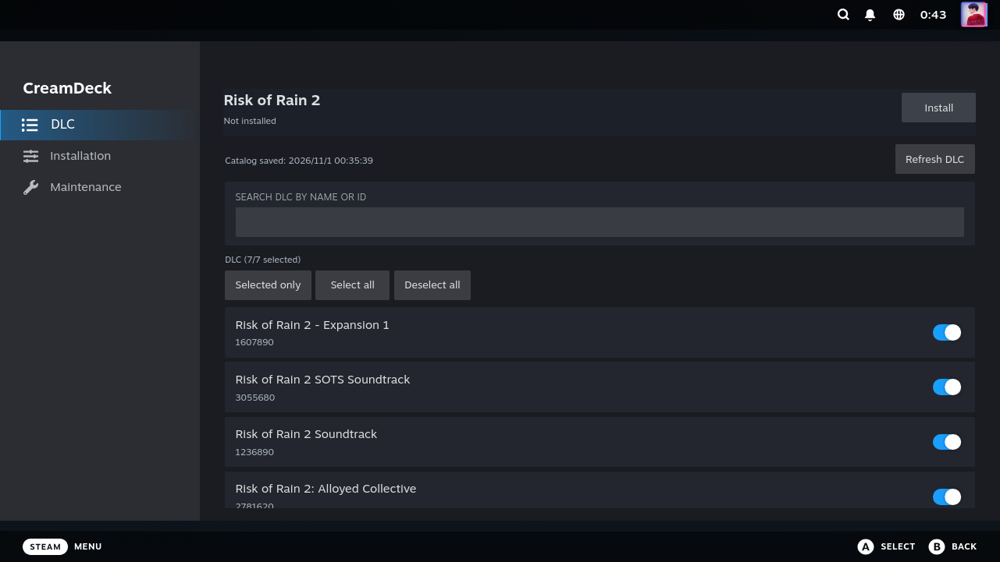

# CreamDeck

[](https://github.com/Qiming-Liu/CreamDeck/actions/workflows/pr-build-test.yml)
[](./LICENSE)

CreamDeck is a [Decky Loader](https://github.com/SteamDeckHomebrew/decky-loader) plugin for unlocking installed PC game DLC (via SmokeAPI or CreamAPI) directly on your Deck — a port of [CreamInstaller](https://github.com/FroggMaster/CreamInstaller)'s core DLC-selection and install/uninstall flow, focused on the one storefront that's already running through Proton on-device.



## Installation

1. Enable Developer Mode in Decky Loader.
2. Download `CreamDeck.zip` from the [latest release](https://github.com/Qiming-Liu/CreamDeck/releases/latest).
3. Install the ZIP through Decky Loader's developer settings.

> [!IMPORTANT]
> Download **`CreamDeck.zip`**, not GitHub's automatically generated **`Source code.zip`**. The source archive does not contain the packaged Decky plugin.

## Usage

1. In your game library, right-click any installed game.
2. Choose **CreamDeck** from the context menu.
3. Open **Installation** to choose a target directory, unlocker and install method. Use **Check installation** to check resources, permissions and conflicting files before installing.
4. Open **DLC** to select content, search by name or ID, or show only selected DLC. Bulk actions apply to the current search/filter results.
5. Click **Install** in the top action bar. Later DLC changes use **Apply changes**; to change the unlocker or install method, uninstall from **Maintenance** first.

New installations default to **SmokeAPI + proxy mode + version.dll**, the combination
tested with **Risk of Rain 2**. In Installation, enable the **Proton launch option** switch to add
`WINEDLLOVERRIDES="version=n,b" %command%` while preserving existing launch options.
Saved configurations for existing installations are kept.

> [!NOTE]
> An unlocker only spoofs the platform's *ownership check* — it does not download DLC content. If a DLC's actual files were never downloaded (because your account doesn't own it), unlocking it will make the game think it owns content it can't actually load, which can crash on launch. This does **not** apply to every DLC on every game, though: some games (Risk of Rain 2 among them — see [Tested games](#tested-games)) ship all DLC content in the base install for everyone, specifically so mixed-ownership multiplayer lobbies work — for those, a full **Verify integrity of game files** in the client (see [Troubleshooting](#troubleshooting)) is enough to have the content locally even without owning it.
>
> CreamDeck flags exactly which DLC this applies to: any DLC listed with a **⚠** has its own depot on Steam (the same data [SteamDB's "Depots" tab](https://steamdb.info/app/394360/depots/) for a game shows), meaning it ships actual content files rather than just an ownership flag — unlocking it is more likely to need those files already present to actually work.

CreamDeck's UI follows your Steam client's language setting, with separate Simplified Chinese, Traditional Chinese and English translations.

### Installation checks and recovery

CreamDeck discovers target folders up to four levels below the game's root,
visiting at most 512 folders and skipping directory symlinks. Choose the folder
containing the platform DLL next to the game executable. The displayed bitness
is inferred from the platform DLL filenames; it is not an executable compatibility test.

Installation and removal run against a staging directory before changing game
files. A recovery journal restores the previous files and install record if
publishing fails or the plugin restarts during an unfinished operation.
Keep `.creamdeck-transaction` intact if recovery reports an error; it contains
the files needed for manual restoration.

New install records include file hashes, the target folder and the CreamDeck
version used. **Installed files verified** means those recorded files match;
**Proton launch option ready** reports Steam's launch setting. Neither status
verifies that DLC is usable inside the running game.

Maintenance restores unchanged original backups and removes verified CreamDeck
files. Files changed by a game update or another tool are kept and listed in
the result. An older installation without hashes must first be removed through
Maintenance; CreamDeck only adopts it for cleanup if its DLLs can be verified.
Unrecognized installations or altered backups require manual restoration.

The local installation state loads independently of Steam metadata requests.
The DLC page shows the catalog's saved time and provides **Refresh DLC**.
A failed refresh keeps the last catalog and does not block Maintenance.
Installations requiring a DLC list stay disabled until a catalog is available.
Install records use atomic replacement; invalid JSON is preserved as
`install_state.json.corrupt-<timestamp>` for inspection.

### Unlockers

| Unlocker | Target file | DLC list? |
|---|---|---|
| SmokeAPI | `steam_api(64).dll` | Yes |
| CreamAPI | `steam_api(64).dll` | Yes |

SmokeAPI and CreamAPI target the exact same file — they're alternatives, not both installed at once.

If upgrading from a version with other unlockers, uninstall those installations with the previous CreamDeck version first. Unsupported install records are preserved and block further changes. If restoring files with another installer, also remove that game's obsolete entry from `install_state.json` after restoration, with CreamDeck stopped.

### Proxy mode

SmokeAPI and CreamAPI can install as a proxy DLL instead of replacing the unlocker's target file directly — useful if a game doesn't get along with a direct replacement, and the only mode that survives a **Verify integrity of game files** (see [Troubleshooting](#troubleshooting)). Toggle **Use a proxy DLL** on the game's CreamDeck page and pick a filename.

> [!IMPORTANT]
> Proxy mode needs one extra step that's specific to Proton: Wine ships its own built-in `winmm.dll`/`version.dll`/`winhttp.dll` and prefers those over the one CreamDeck drops into the game folder, so **the unlocker's hook silently never runs** unless this game's launch options tell Proton to prefer the dropped-in file (`WINEDLLOVERRIDES="<dll>=n,b" %command%`). The symptom is the game launching fine with DLC still locked, no error at all. CreamDeck's Installation page has a **Proton launch option** switch that reflects the current Steam setting. Turning it on adds the selected DLL override; turning it off removes only that DLL's override while preserving other DLL rules and launch arguments — you still need to fully close and relaunch the game afterward for it to take effect.

## Scope

CreamDeck v1 only covers **games running through Proton, installed via the one storefront already present on a Deck out of the box**. It does not (yet) support:

- Epic/Ubisoft games via Heroic Games Launcher
- Native-Linux-build games (a different unlock mechanism entirely — LD_PRELOAD — that acidicoala's Windows DLLs can't do)
- A library-wide batch scan — each game's DLC list is fetched on demand when you open its CreamDeck page, not up front

## Tested games

### Risk of Rain 2

1. Open the game's CreamDeck page, pick **SmokeAPI**.
2. Enable **Use a proxy DLL**, pick `version`, then enable **Proton launch option** (see [Proxy mode](#proxy-mode)) — required on Proton or the unlock silently never applies.
3. If you haven't already, run **Verify integrity of game files** once before installing — Risk of Rain 2 ships all DLC content in the base install for everyone, so this alone is enough to have it locally even without owning it (see the note in [Usage](#usage)).
4. Check the DLC you want unlocked and click **Install**.
5. Fully close and relaunch the game (a launch-options change only takes effect on a fresh launch).

Confirmed working: game launches clean, DLC shows unlocked in-game, survives a later **Verify integrity** without needing to redo the launch-option step (only a reinstall through CreamDeck, since verify always undoes the DLL swap itself).

### Street Fighter 6

1. Open the game's CreamDeck page, pick **SmokeAPI**.
2. Enable **Use a proxy DLL**, pick **version.dll**, then enable **Proton launch option** (see [Proxy mode](#proxy-mode)) — required on Proton or the unlock silently never applies.
3. Check the DLC you want unlocked and click **Install**.
4. Fully close and relaunch the game (a launch-options change only takes effect on a fresh launch).

Confirmed working: game launches clean, DLC unlocked in-game.

## Troubleshooting

- **Game launches fine but DLC is still locked, no error shown** — almost always the Proton/WINEDLLOVERRIDES issue described in [Proxy mode](#proxy-mode) above, if you're using proxy mode. Enable the **Proton launch option** switch on the game's Installation page, then fully close and relaunch the game.
- **Game crashes on launch after installing** — check whether the DLC you enabled actually has its content downloaded (see the note in [Usage](#usage)); if so, disable that DLC and try again with just the ones whose content you know is present.
- **"Files need repair" status** — the recorded file hashes no longer match. Open **Maintenance** and use **Clean verified files** to remove verified leftovers before reinstalling. Files changed by Steam or another tool are preserved; changed original backups require manual restoration.
- **After Verify integrity**, a direct-replace (non-proxy) install is always undone — the client restores the original DLL as part of verifying, same as after most game updates. Reinstall through CreamDeck afterward, or switch to Proxy mode with the launch option set so it survives future verifies/updates.
- If DLCs still aren't recognized after installing, try **Proxy mode** with a different DLL name.
- If a game's DLC list fails to fetch, its last saved catalog remains available. Use **Refresh DLC** or reopen the page to retry.
- Antivirus software may flag the vendored unlocker DLLs — see [CreamInstaller's false-positive explanation](https://github.com/FroggMaster/CreamInstaller#false-positive-antivirus-detections) for why (DLL replacement + process hooking read as suspicious to heuristic scanners even when benign).
- For anything else, check `creamdeck_actions.log` in Decky's plugin log directory (`~/homebrew/logs/CreamDeck/`) — every install/uninstall/page-load action is logged there with its arguments, outcome, and the plugin version, separate from Decky's own per-session log files.

## Development

See [`.github/workflows/`](.github/workflows) for the CI that build/type-checks the frontend and runs the backend's unit tests on every PR, and [`pull_request_template.md`](.github/pull_request_template.md) for what's expected before merging a fix.

```bash
pnpm install
pnpm run build
python -m unittest discover -s tests -v
```

### Live testing in a VM or on a Deck

`scripts/dev.mjs` builds locally and synchronizes the plugin over SSH to a SteamOS
VM or Deck. Copy `.env.example` to `.env`, configure SSH key login, then run:

```bash
pnpm dev
```

The remote session asks for sudo once if needed, backs up the installed runtime,
links it to a source mirror under `/tmp`, and enables Decky's `LIVE_RELOAD`.
Edits rebuild and synchronize automatically; backend changes restart Decky, and
frontend changes request a plugin reload. Ctrl+C restores the normal install.
An already-open game page may need reopening after a reload.

See [`scripts/DEV.md`](scripts/DEV.md) for host/guest requirements, connection
settings, cleanup behavior, and verification commands.

## Acknowledgments

- [CreamInstaller](https://github.com/FroggMaster/CreamInstaller) — the Windows tool this plugin ports, and the source of every unlocker DLL it vendors ([decky/resources/](resources))
- [CheatDeck](https://github.com/SheffeyG/CheatDeck) — the per-game context-menu → dedicated page navigation pattern this plugin's UI is built on
- [decky-steamgriddb](https://github.com/SteamGridDB/decky-steamgriddb) — the original library-context-menu-patching technique CheatDeck (and in turn this plugin) reuses
- **CreamAPI** by deadmau5, and **SmokeAPI** by [acidicoala](https://github.com/acidicoala) — the actual DLC unlockers this plugin installs (SmokeAPI: Unlicense)
