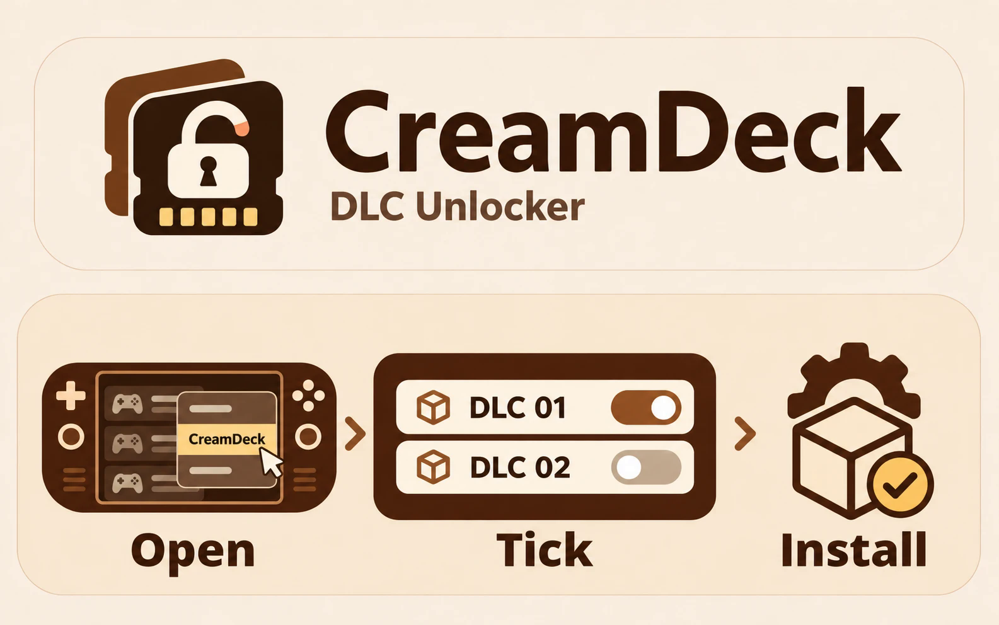
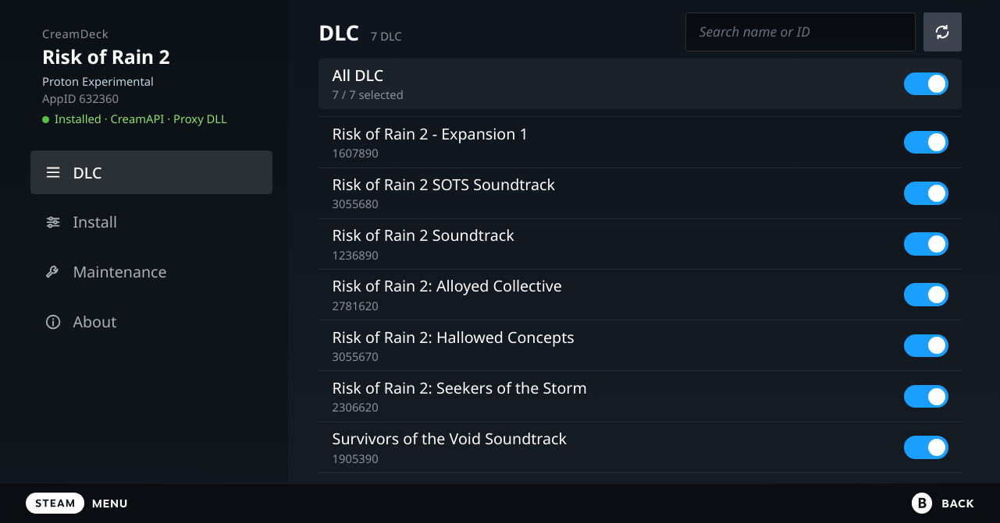
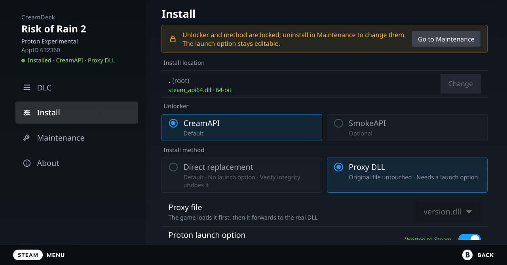

# CreamDeck

English | [简体中文](README.zh-CN.md) | [繁體中文](README.zh-TW.md)

A [Decky Loader](https://github.com/SteamDeckHomebrew/decky-loader) plugin for
managing Steam DLC unlockers on Steam Deck, using **SmokeAPI** and **CreamAPI**.
Supports Windows games running through Proton; native Linux games are not supported.

## Installation

Download **CreamDeck.&lt;version&gt;.zip** from the [latest release](https://gitlab.com/alan-liu/CreamDeck/-/releases/permalink/latest)
and install it through Decky Loader's developer settings. Use the plugin ZIP,
not GitLab's **Source code (zip)**.

## Using the plugin

Open **CreamDeck** from an installed game's library context menu.

The sidebar shows the game, its Proton version and install status. The page
has four tabs:

1. **DLC**: search and select DLC, then install or apply the changes from the
   bar at the bottom (**X** applies, **Y** discards on a controller). On a
   first install, DLC with separate files start switched off.
2. **Install**: choose the install location, unlocker and install method.
   The folder must contain `steam_api.dll` or `steam_api64.dll`. If automatic
   detection misses it, choose **Change** and enter its path relative to the
   game installation. The Proton launch option row shows what Steam has, with
   this plugin's own item in blue.
3. **Maintenance**: see how each installed file will be handled, then
   uninstall. Files changed by a game update or another tool are kept.
4. **About**: version, update notice, feedback QR code, credits and the shared
   log (export it and attach the file when reporting a problem).

Games that don't run with Proton show a single "Not supported" page.

The Quick Access panel shows how to open a game's page and lists games with an
unlocker. A game that Steam has uninstalled is marked **No longer in the
library**; **Remove** clears its record and, when the folder it left behind can
be identified, the unlocker files still in it.

New installations default to **CreamAPI + direct replacement**. Uninstall
first to change the unlocker or install method; the DLC selection is kept for
the next install.

## Important notes

- Unlockers do **not** download DLC files. Required content must already be
  installed; enabling missing content can cause crashes. **Has separate files**
  marks DLC with its own Steam depot.
- Proxy mode requires `WINEDLLOVERRIDES="version=n,b" %command%` when using
  `version.dll`. CreamDeck adds it after a proxy install and the Proton launch
  option switch manages it while preserving other launch options. If DLC stays
  locked, check the switch and restart the game.
- Steam's **Verify integrity** restores DLLs replaced by direct installation.
  Reinstall afterward, or use proxy mode.
- If files need repair, open **Maintenance** before reinstalling. A failed
  catalog refresh keeps cached DLC data and leaves Maintenance available.

## Special thanks

- [CreamInstaller](https://github.com/FroggMaster/CreamInstaller) for the original
  DLC selection and installation workflow and bundled unlocker resources.
- **CreamAPI** by deadmau5 and **SmokeAPI** by [acidicoala](https://github.com/acidicoala).

## License

GPL-3.0. Bundled unlocker resources retain their respective licenses.
