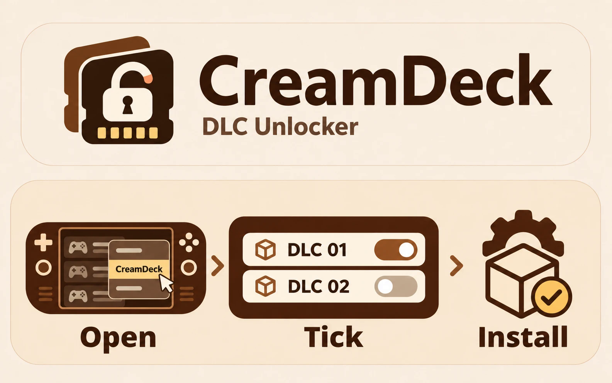
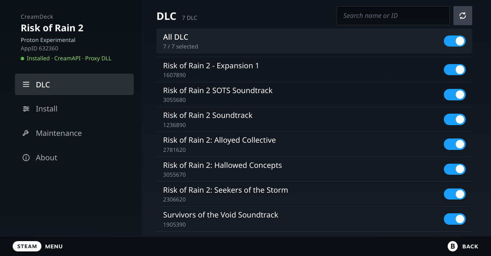
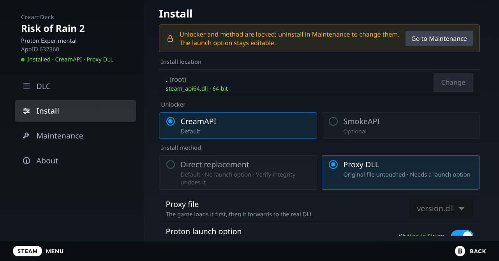

# CreamDeck

[English](README.md) | 简体中文 | [繁體中文](README.zh-TW.md)

一款 [Decky Loader](https://github.com/SteamDeckHomebrew/decky-loader) 插件，在 Steam Deck 上管理 Steam DLC 解锁器，使用 **SmokeAPI** 和 **CreamAPI**。
支持通过 Proton 运行的 Windows 游戏，不支持原生 Linux 游戏。

## 安装

从[最新版本](https://gitlab.com/alan-liu/CreamDeck/-/releases/permalink/latest)下载 **CreamDeck.&lt;版本号&gt;.zip**，在 Decky Loader 的开发者设置里安装。请使用插件 ZIP，不要用 GitLab 的 **Source code (zip)**。

## 使用方法

从已安装游戏的库右键菜单打开 **CreamDeck**。

侧边栏显示游戏、它的 Proton 版本和安装状态。页面有四个标签页：

1. **DLC**：搜索并选择 DLC，然后在底部栏安装或应用改动（手柄上 **X** 应用、**Y** 放弃）。首次安装时，带独立文件的 DLC 默认关闭。
2. **安装**：选择安装位置、解锁器和安装方式。所选文件夹里必须有 `steam_api.dll` 或 `steam_api64.dll`。如果自动检测没找到，点 **更改**，输入它相对于游戏安装目录的路径。「Proton 启动项」一行显示 Steam 里的当前内容，本插件自己的项以蓝色标出。
3. **维护**：查看每个已安装文件卸载时会怎么处理，然后卸载。被游戏更新或其他工具改过的文件会保留。
4. **关于**：版本、更新提示、反馈二维码、致谢和共享日志（反馈问题时请导出日志并附上文件）。

不通过 Proton 运行的游戏只显示一个「不支持」页面。

快捷访问菜单会显示打开游戏页面的指引，并列出装了解锁器的游戏。已被 Steam 卸载的游戏会标为 **已不在库里**；点 **清除** 会删除它的记录，如果能认出它留下的文件夹，还会删除里面残留的解锁器文件。

新安装默认使用 **CreamAPI + 直接替换**。要更换解锁器或安装方式，请先卸载；DLC 选择会保留到下次安装。

## 注意事项

- 解锁器 **不会** 下载 DLC 文件。需要的内容必须已经安装；启用缺失的内容可能导致崩溃。**有独立文件** 表示该 DLC 有自己的 Steam 仓库（depot）。
- 使用 `version.dll` 的代理模式需要启动项 `WINEDLLOVERRIDES="version=n,b" %command%`。代理安装后 CreamDeck 会自动加上，「Proton 启动项」开关会管理它，并保留其他启动项。如果 DLC 仍然没解锁，检查这个开关并重启游戏。
- Steam 的 **验证文件完整性** 会恢复被直接替换的 DLL。验证后请重新安装，或改用代理模式。
- 如果文件需要修复，请先打开 **维护** 再重新安装。DLC 目录刷新失败时会保留缓存的 DLC 数据，**维护** 仍然可用。

## 特别感谢

- [CreamInstaller](https://github.com/FroggMaster/CreamInstaller)：最初的 DLC 选择和安装流程，以及内置的解锁器资源。
- deadmau5 的 **CreamAPI** 和 [acidicoala](https://github.com/acidicoala) 的 **SmokeAPI**。

## 许可证

GPL-3.0。内置的解锁器资源保留各自的许可证。
