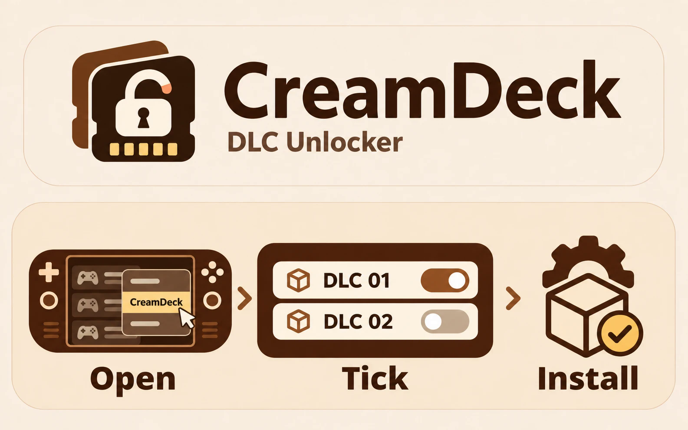
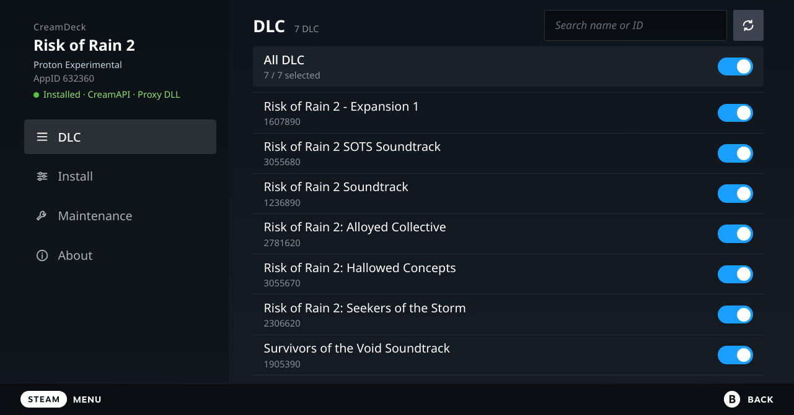
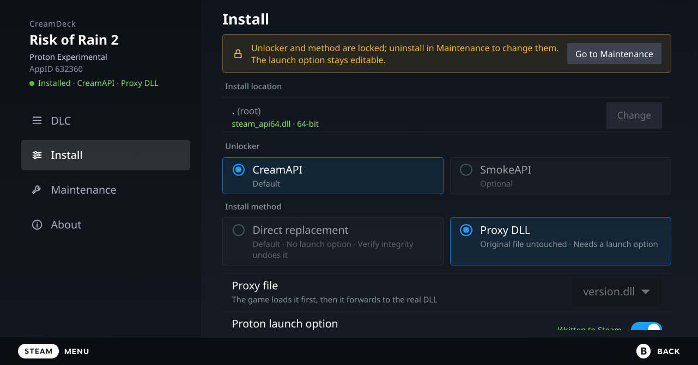

# CreamDeck

[English](README.md) | [简体中文](README.zh-CN.md) | 繁體中文

一款 [Decky Loader](https://github.com/SteamDeckHomebrew/decky-loader) 外掛，在 Steam Deck 上管理 Steam DLC 解鎖器，使用 **SmokeAPI** 和 **CreamAPI**。
支援透過 Proton 執行的 Windows 遊戲，不支援原生 Linux 遊戲。

## 安裝

從[最新版本](https://github.com/Qiming-Liu/CreamDeck/releases/latest)下載 **CreamDeck.&lt;版本號&gt;.zip**，在 Decky Loader 的開發者設定裡安裝。請使用外掛 ZIP，不要用 GitHub 的 **Source code (zip)**。

## 使用方法

從已安裝遊戲的收藏庫右鍵選單開啟 **CreamDeck**。

側邊欄顯示遊戲、它的 Proton 版本和安裝狀態。頁面有四個分頁：

1. **DLC**：搜尋並選擇 DLC，然後在底部列安裝或套用變更（手把上 **X** 套用、**Y** 放棄）。首次安裝時，帶獨立檔案的 DLC 預設關閉。
2. **安裝**：選擇安裝位置、解鎖器和安裝方式。所選資料夾裡必須有 `steam_api.dll` 或 `steam_api64.dll`。如果自動偵測沒找到，點 **變更**，輸入它相對於遊戲安裝目錄的路徑。「Proton 啟動選項」一列顯示 Steam 裡的目前內容，本外掛自己的項目以藍色標出。
3. **維護**：查看每個已安裝檔案解除安裝時會怎麼處理，然後解除安裝。被遊戲更新或其他工具改過的檔案會保留。
4. **關於**：版本、更新提示、回報 QR 碼、致謝和共用日誌（回報問題時請匯出日誌並附上檔案）。

不透過 Proton 執行的遊戲只顯示一個「不支援」頁面。

快速存取選單會顯示開啟遊戲頁面的指引，並列出裝了解鎖器的遊戲。已被 Steam 解除安裝的遊戲會標為 **已不在收藏庫**；點 **清除** 會刪除它的紀錄，如果能認出它留下的資料夾，還會刪除裡面殘留的解鎖器檔案。

新安裝預設使用 **CreamAPI + 直接替換**。要更換解鎖器或安裝方式，請先解除安裝；DLC 選擇會保留到下次安裝。

## 注意事項

- 解鎖器 **不會** 下載 DLC 檔案。需要的內容必須已經安裝；啟用缺少的內容可能導致當機。**有獨立檔案** 表示該 DLC 有自己的 Steam 儲存庫（depot）。
- 使用 `version.dll` 的代理模式需要啟動選項 `WINEDLLOVERRIDES="version=n,b" %command%`。代理安裝後 CreamDeck 會自動加上，「Proton 啟動選項」開關會管理它，並保留其他啟動選項。如果 DLC 仍然沒解鎖，檢查這個開關並重新啟動遊戲。
- Steam 的 **驗證檔案完整性** 會還原被直接替換的 DLL。驗證後請重新安裝，或改用代理模式。
- 如果檔案需要修復，請先開啟 **維護** 再重新安裝。DLC 目錄重新整理失敗時會保留快取的 DLC 資料，**維護** 仍然可用。

## 特別感謝

- [CreamInstaller](https://github.com/FroggMaster/CreamInstaller)：最初的 DLC 選擇和安裝流程，以及內建的解鎖器資源。
- deadmau5 的 **CreamAPI** 和 [acidicoala](https://github.com/acidicoala) 的 **SmokeAPI**。

## 授權

GPL-3.0。內建的解鎖器資源保留各自的授權。
